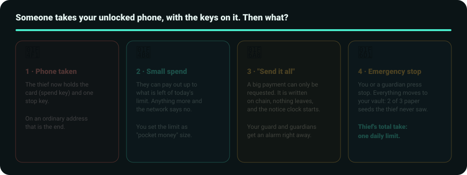

<p align="center"></p>

<p align="center">
<b>A self-custody Kaspa savings account for Android whose rules are enforced by the Kaspa network itself.</b><br>
Someone who steals your phone and the keys on it can take, at most, one day's spending limit.
</p>

<p align="center">
<a href="#what-is-kaspa">What is Kaspa</a> ·
<a href="#what-is-a-covenant">What is a covenant</a> ·
<a href="#why-stolen-keys-are-not-enough">Why stolen keys are not enough</a> ·
<a href="#features">Features</a> ·
<a href="#build-it-yourself">Build it</a> ·
<a href="docs/CONTRACT.md">The covenant</a> ·
<a href="SECURITY.md">Security</a>
</p>

---

## The problem with every crypto wallet

On an ordinary crypto address, **the key is the money**. The network asks one question before it moves your coins:
*was this signed with the right key?* If a thief gets your key (a stolen phone, a photographed seed phrase, a bit of
malware), they can send everything, to anywhere, in one second, and nobody can stop or undo it.

KaspaVault changes the question. Its account is a **covenant**: a coin that carries its own spending rules, which every
Kaspa node checks before accepting a payment. The key alone is no longer enough.

<p align="center"></p>

## What is Kaspa?

**Kaspa** is a proof-of-work cryptocurrency, secured by mining like Bitcoin, fair-launched in November 2021 with no
pre-mine and no pre-sale. Its coin is **KAS**, with a fixed maximum supply of about 28.7 billion.

What makes it different is how blocks fit together. A normal blockchain is a single file: one block at a time, and when
two miners find a block at once, one of them is thrown away. That forces blocks to be slow. Kaspa is a **blockDAG**:
blocks made at the same moment are all kept and woven together, and an ordering rule (GHOSTDAG) agrees on the order of
every transaction in them. So Kaspa makes about **ten blocks every second** and a payment is confirmed in seconds,
without giving up proof-of-work.

<p align="center"></p>

Kaspa's **Toccata** upgrade gave its scripts two new powers: a coin's lock can now *look at the transaction trying to
spend it* (where the money is going, how much, how long the coin has waited), and the network now *tracks a coin's
lineage* from one move to the next. Those two powers are what make a covenant possible.

## What is a covenant?

Every Kaspa coin sits behind a small program, its lock. For an ordinary address, the lock is one line: *show a valid
signature from this key*. A covenant's lock is a longer program that also checks **what the payment does**:

| The lock asks | What KaspaVault's covenant requires |
|---|---|
| Who signed? | The right key **for this kind of move**: the card for spending, a stop key for the emergency stop, the heir key for a claim |
| How much? | No more than what is left of the **daily limit**, fees included |
| Where to? | For a big payment, only the destination announced earlier. For a stop, only **your vault** |
| When? | A big payment only after its **notice period**; a claim only after a long **inactivity period** |
| What is left? | The change must go back into a new coin with **exactly the same rules** and correctly updated state |

That last row is the trick: **the rules travel with the money.** Every time the account moves, the network demands that
what stays behind is locked by the same covenant, so the only ways money can leave are the ones the rules list.

A payment that breaks a rule is not blocked by KaspaVault, by a company or by a server. It is simply **invalid**, the
same way a forged signature is invalid: every node in the network refuses it. Nobody can switch the rules off: not a
thief, not the app's authors, not you. (You change rules by sending the account to your vault and opening a new one.)

Think of it as a bank account with a withdrawal limit, a cooling-off period on big transfers and a panic button, except
the bank is the whole Kaspa network and there is no bank employee to trick.

## Why stolen keys are not enough

<p align="center"></p>

The account's power is split across keys kept in different places, and each key can only do one narrow thing:

| Key | Where it lives | The worst it can do in the wrong hands |
|---|---|---|
| **Card** (spend key) | Your phone, sealed behind your fingerprint | Spend up to one daily limit. A bigger payment must be announced on chain and wait out the notice period, while alarms ring |
| **Stop keys** (three) | One on your phone; the others with guardians, people you trust, on their own phones | Freeze the account into **your own vault**. A stop can pay nothing else |
| **Heir key** | Your heir's phone | Nothing, until the account has gone untouched for the whole inactivity period (six months by default) |
| **Vault seeds** (three) | Paper, kept in three different places | Any **two** open the vault. This is the one thing to guard like gold |

Take the worst case: a thief gets your phone open, past the fingerprint lock. They now hold the card *and* a stop key,
and still the most they can take is
what is left of today's limit. If they ask for more, the request sits on chain for the notice period, your phone's guard
and your guardians' phones raise an alarm, and anyone with a stop key sends the whole account to your vault, which
needs paper seeds the thief has never seen. If they press the stop themselves, they have only moved your money to you.

**The honest fine print.** Nothing here is magic:

- Spending within the limit cannot be stopped; that is the price of being able to pay at a shop. Set the limit to an
  amount you could stand to lose.
- If nobody presses stop before a notice period ends, the announced payment goes through. That is why the guard watches
  two Kaspa nodes and why guardians exist; choose a notice period long enough to react.
- Two vault seeds kept together, or kept with the phone, give a thief everything. Keep them apart.
- The covenant has been tested hard (see the status note below), but it has had AI reviews, not a human audit.

> Status: each covenant entry is checked against the real Kaspa script engine by the test matrix in
> [docs/TESTING.md](docs/TESTING.md). Testnet-10 runs showed the network itself enforcing the time rules listed there
> (notice period, limit window, inactivity period before a claim) and the daily limit, and exercised the emergency
> stop, decline and claim, including guardians and heirs on a second phone. The hard-limit dial has not run on chain
> yet. The app runs on mainnet; a mainnet proof round has not been run.

## Features

- **Daily limit.** Payments up to the limit go out at once, with a fingerprint. Fees count toward the limit. The limit
  refreshes once a full window has passed since the last payment, not at midnight.
- **Notice period.** A payment above the limit is first *requested*: the destination and amount are written on chain
  and nothing leaves. It can be completed only after the notice period, only to that destination, only for that amount.
- **Decline.** Any of the three emergency stop buttons (each one a stop key) can send a waiting payment back to the
  account. Nothing moves.
- **Emergency stop.** Any of the three emergency stop buttons moves the whole account to the vault, from any state.
  The stop can only ever pay the vault; a stop key in the wrong hands can freeze the account, never take from it.
- **2-of-3 vault.** The vault is an ordinary Kaspa multisig address opened by any two of three vault seeds of 24 words.
- **Heir.** After an inactivity period you choose (six months by default on mainnet), an heir can claim the account.
  Any payment, request, completion, decline or top-up restarts the clock; a claim pressed early is refused with the
  time left. Optionally the guard sends the inheritance by itself.
- **Guardians and heirs on their own phones.** A person you trust installs KaspaVault and gives you a link code. As a
  guardian they hold one of your stop keys: they can decline a waiting payment or stop the account to your vault,
  never take from it. As an heir they hold the heir key and can claim after the inactivity period; what a claim pays
  lands in their own heir purse, which they spend like any address. A watch code lets their phone follow your account
  without holding anything that can spend. Removing a guardian puts a key nobody holds in their stop slot.
- **Hard limit (optional).** A dial that switches large withdrawals off for good: the daily limit becomes the only
  way out for the card, and the rest leaves only through the stop or the heir.
- **Guard.** A foreground service on the phone follows the account on two independent Kaspa nodes and raises an
  alarm when money moves, when a withdrawal is requested, when the nodes disagree, or when it stops hearing from them.
  A second, watch-only guard can run on another device from a public file; it holds nothing that can spend.
- **Everyday purse.** A plain address for small payments and for topping up the account.
- **Several accounts**, each with its own rules. Changing the rules (limit, notice, guardians, heir) means closing the
  account and opening it again under the new rules. With the vault seeds on the phone, Update now does it at once
  (stop to the vault, take out with a fingerprint, reopen); otherwise the update waits out the notice period.
- **Sample mode.** Every screen can be tried with made-up money before any keys exist.

## How it works

There are three places funds can be.

- **The purse** is an ordinary single-key address on the phone. It has no rules; treat it like pocket cash.
- **The account** is a covenant coin. The phone holds the *card* (the spend key) and one *stop key*. The card can
  spend within the limit or request a larger payment; it cannot skip the notice period, change the destination of a
  waiting payment, or touch the vault. Each of the two other stop slots holds a guardian's key (a person you trust,
  on their own phone) or a key nobody holds.
- **The vault** is a 2-of-3 multisig address. Its keys are three vault seeds of 24 words, written on paper and kept in
  three places. The account's rules know only the vault's address. The phone makes the vault seeds, keeps them sealed
  so they can be shown again, and can delete them from the phone once the paper copies are safe. (The command-line
  client can also make them on a separate offline device.)

Every key on the phone is sealed by the Android Keystore behind a strong biometric (or the device credential). It is
unsealed for the moment of a signature and wiped. Moves that cannot be undone (taking funds out of the vault, showing
or deleting the vault seeds, resetting the keys, changing the heir, a guardian's stop, an heir's claim) need a fresh
fingerprint every time.

The engine is the same Rust program used for the testnet proofs, built as a native library and called from a thin
Java shell. The screens are a local web page under a strict content security policy. The only network traffic is to
Kaspa nodes and to one price feed for the KAS chart.

## Self-custody

KaspaVault keeps no copy of anything. There is no company, server or support desk that can see a balance, reverse a
payment, reset a key or restore a lost vault seed. If the keys on the phone are lost, the funds in the account are reached
through another stop key and the vault; if two of the three vault seeds are lost, the funds in the vault cannot be
recovered by anyone. Adding a fingerprint to the phone clears the everyday keys the app keeps on it, by design; the
phone's copy of the vault seeds stays. Still keep at least two vault seeds on paper: the phone can be lost.

## Build it yourself

Everything is open source: the covenant, the engine, the app and every test.

<details>
<summary><b>Repository layout</b></summary>

| Path | What it is |
|---|---|
| `contracts/` | `vault.sil`, the covenant, written in SilverScript |
| `engine-tests/` | Proofs that run the compiled covenant through the real Kaspa script engine (`kaspa-txscript` 2.1.0) |
| `testnet-client/` | The Rust wallet engine (`vault_core`): keys, transaction building, the covenant client, the guard, the offline signer, and the command-line driver used for the testnet runs |
| `app/android/` | The Android shell: activity, signer, guard service, manifest, and the Gradle-free build scripts |
| `app/web/` | The app's screens: one local HTML page with its scripts and styles |
| `app/web-tests/` | Tests for the page: data layer against a fake engine, house-rule lint, headless smoke test |
| `tools/` | `fetch_vendor.sh` (fetches the SilverScript compiler, see Building), `mutate.py` (the mutation tester for the covenant), `surface_check.py` (fails when the page's routes, the bridge's allow-lists, the settings keys and the engine's methods drift apart) |
| `vendor/` | Path dependencies: a patched `kaspa-hashes` (in this repository) and the SilverScript compiler (fetched into `vendor/silverscript/` by `tools/fetch_vendor.sh`) |
| `docs/` | [CONTRACT.md](docs/CONTRACT.md), the covenant entry by entry, and [TESTING.md](docs/TESTING.md), what each test layer proves; [SECURITY.md](SECURITY.md) sits at the top level |

</details>

<details>
<summary><b>Building the app</b></summary>

After a one-time fetch of the compiler, the build has two steps: the Rust engine as an Android library, then the
APK. No Gradle is used. The scripts are bash
and currently expect the Windows layout of the Android SDK (`%LOCALAPPDATA%\Android\Sdk`, tools with `.exe`/`.bat`
suffixes), run from Git Bash.

Requirements:

- Rust 1.94 or newer (the SilverScript compiler's minimum; the repository's `rust-toolchain.toml` pins it, so
  rustup selects it by itself) with the `aarch64-linux-android` target: `rustup target add aarch64-linux-android`
- [cargo-ndk](https://github.com/bbqsrc/cargo-ndk) (the scripts are written against 4.1.2): `cargo install cargo-ndk`
- Android SDK with build-tools 36.1.0, platform `android-36`, and an NDK (Android Studio, SDK Manager). The newest
  NDK under the SDK is used unless `ANDROID_NDK_HOME` is set.
- A JDK providing `javac`, `jar` and `keytool` (the scripts put Android Studio's bundled JBR on the path)
- git, for the one-time fetch below

Step 0, the vendored compiler (once, before building or running any Rust check):

```bash
bash tools/fetch_vendor.sh
```

This clones `kaspanet/silverscript` at a pinned commit into `vendor/silverscript/` and applies
`tools/silverscript-443d519.patch` (`kaspa-hashes` without its assembly, a crates.io patch, and an optional
zero-knowledge feature). It then checks that `vendor/kaspa-hashes-patched` (`kaspa-hashes` 2.1.0 whose build script
honours the no-asm feature, shipped in this repository) is present. The engine and the covenant proofs build against
both as path dependencies, so nothing compiles without this step.

Step 1, the engine library (slow the first time: it compiles about 400 crates):

```bash
bash app/android/build-native.sh
```

This runs `cargo ndk -t arm64-v8a --platform 33 build --profile phone --no-default-features` in `testnet-client/`
and leaves `app/android/jniLibs/arm64-v8a/libvault_core.so`, printing its size and SHA-256. The `phone` profile is
release with `opt-level = "z"`, LTO, one codegen unit and stripped symbols. `--no-default-features` leaves out the
laptop-only parts (command line, TLS service) and the zero-knowledge builtins the vault does not use. The script sets
its own `CARGO_TARGET_DIR`; edit that line if the default location does not suit your machine.

Step 2, the APK:

```bash
bash app/android/build.sh
```

This runs aapt2, javac, d8, zipalign and apksigner, bundles `app/web/` as assets, packs the library, bumps
`android:versionCode` in the manifest, and writes `app/android/build/KaspaVault.apk`. It prints the unsigned APK's
SHA-256 (the build id), the library's SHA-256 and the signing certificate's SHA-256. Jar entries carry a fixed date,
so the same sources and version code give the same unsigned bytes.

Signing: without configuration the APK is signed with a debug key generated beside the script, and the build says so.
For a release, set `KV_KEYSTORE`, `KV_KEY_ALIAS`, `KV_STORE_PASS` and optionally `KV_KEY_PASS`, or put `keystore=`,
`alias=`, `storePass=` and `keyPass=` lines in `~/.kaspavault/release.properties`. An APK signed with one key cannot be
installed over one signed with another; switching keys means uninstalling, which erases the keys sealed on the phone.
`KV_DEBUGGABLE=1` makes a debuggable build for pushing test data (debug key only; never for real use).

The app runs on Android 13 and later (minSdk 33, targetSdk 35), arm64 only.

</details>

<details>
<summary><b>Running the checks</b></summary>

```bash
# Once, before any Rust check: bash tools/fetch_vendor.sh (see Building)

# Wallet engine unit tests (from testnet-client/)
cargo test --lib
cargo clippy

# Covenant proofs in the real Kaspa script engine (from engine-tests/)
cargo test --test vault -- --nocapture
cargo test --test review2 -- --nocapture

# Mutation test of the covenant: build the test binary, then pass its path (from the repository root)
(cd engine-tests && cargo test --test vault --no-run)    # prints the path of the test executable
python tools/mutate.py <absolute path to that executable>

# Page tests (from the repository root, Node 18 or newer)
node --test app/web-tests/data.test.js
node app/web-tests/pagelint.js
KV_CHROME=<path to a headless Chromium> node app/web-tests/smoke.js          # Sample mode
KV_CHROME=<path to a headless Chromium> node app/web-tests/smoke.js --live   # phone page with a fake bridge
```

What each layer proves, and the testnet transaction ids, are in [docs/TESTING.md](docs/TESTING.md). It also says what
each layer cannot prove: the engine proofs cover the cases in their matrix, mutation testing mutates the covenant's
`require` lines (not `if` conditions or arithmetic), and the adversarial reviews were separate AI model sessions
given the code without the authors' reasons, not independent human auditors.

</details>

## License

MIT. KaspaVault is not a product and nothing is sold; it was built as a gift for the Kaspa community.
